# MEDISCRIBE – Project Blueprint v3.0

Stateless Clinical Documentation Application

*Project Blueprint · MVP Specification · Privacy, Safety & Governance
Plan*

| **Item**      | **Detail**                                                                                 |
|---------------|--------------------------------------------------------------------------------------------|
| **Version**   | 3.0 (supersedes v2.0, 18 October 2026)                                                     |
| **Date**      | 19 October 2026                                                                            |
| **Status**    | Draft for review – specification, not a declaration of clinical safety or legal compliance |
| **Setting**   | Ugandan referral-hospital outpatient care; first template: cardiology                      |
| **Data rule** | Synthetic data only until written facility, privacy and security approval                  |

<table>
<colgroup>
<col style="width: 100%" />
</colgroup>
<tbody>
<tr class="odd">
<td>
<strong>Guiding principle</strong>

Process temporarily. Review clinically. Approve exactly what is
exported. Retain nothing in Mediscribe.

The session lives only in the doctor's browser tab. The server
answers single requests and forgets them. The approved document is the
only thing that leaves, and it leaves under the doctor's
control.
</td>
</tr>
</tbody>
</table>

# 0. Document control and what changed

Version 3.0 restructures the v2.0 blueprint and resolves the 23 issues
found in the v2.0 review. The main design change is that the session now
lives in the doctor's browser tab and the server is genuinely stateless.
The plan also now covers local languages, extra speaker roles, the
cardiology sections that were missing, user sign-in, and Uganda's Data
Protection and Privacy Act 2019. Governance moves to the start of the
roadmap.

## 0.1 Summary of changes from v2.0

| **v2 issue**                        | **What v3.0 does**                                         | **See**        |
|-------------------------------------|------------------------------------------------------------|----------------|
| A1 List numbering ran on (1–36)     | Every numbered list restarts at 1                          | Whole document |
| A2 Python/Node conflict             | Backend fixed as Python (FastAPI) to match python-docx     | §13            |
| A3 Approve before preview           | Preview first, then approve that exact version (hash)      | §3, §8, §12    |
| B1 Clear-vs-retry conflict          | Two error classes: recoverable (keep) and terminal (clear) | §6.3           |
| B2 State location undefined         | Session held in browser tab only; server stateless         | §5             |
| B3 Timeout undefined                | Activity defined; heartbeat; warning at 13 min             | §6.2           |
| B4 Acknowledged flags unclear       | Unverified items printed visibly on the note               | §4.4           |
| B5 Approval invalidation implied    | Any edit resets approval; render refuses mismatched hash   | §6, §12        |
| C1 Exam findings not spoken         | Manual clinician entry promoted to P0                      | §9 (FR-07)     |
| C2 Missing cardiology sections      | Vitals, investigations, meds, allergies, PMH added         | §4             |
| C3 Only Doctor/Patient/Unknown      | Relative, Other clinician, Interpreter roles               | §7.2           |
| C4 No language/translation          | Language detection + translation stage; originals kept     | §7.1           |
| C5 No author/consent/AI declaration | Generated into header and footer of every export           | §4.3           |
| C6 Automation bias missing          | Must open every HIGH item; review time measured            | §8, §16        |
| D1 No sign-in                       | Facility SSO, identity only                                | §10.4          |
| D2 Batch STT needs bucket           | Streaming/synchronous endpoints only                       | §10.5          |
| D3 Browser leak paths               | Browser hardening list                                     | §10.2          |
| D4 Swap/core dumps/renderer files   | Host hardening list                                        | §10.3          |
| D5 Token transport                  | Header or HttpOnly cookie, never URL                       | §10.4          |
| D6 Uganda law generic               | DPPA 2019 obligations mapped to design                     | §11            |
| E1 Unmeasurable exit criteria       | Numeric acceptance targets                                 | §14, §15       |
| E2 Governance last                  | Governance runs from Phase 0                               | §14            |
| E3 No load test                     | Load test in Phase 5                                       | §15.3          |

# 1. Product vision and scope

Mediscribe helps a doctor turn one consultation conversation into one
structured, traceable clinical note. It records the consultation,
transcribes it in the languages actually spoken, labels who said what,
extracts the clinical facts with their source, and organises them into a
standard note. It flags anything uncertain and requires the doctor to
review and approve before export. Nothing is kept afterwards.

## 1.1 Non-negotiable principles

- **Stateless by design:** no patient database, consultation store,
  document archive or saved history – on the server or in the browser.

- **Doctor control:** the doctor reviews, edits, previews and approves.
  Mediscribe never finalises a note on its own.

- **No silent invention:** missing or unclear details are flagged, never
  guessed – especially doses, routes and frequencies.

- **Source for every fact:** each note item links to a transcript
  segment or is marked 'entered by clinician'.

- **One consultation, one note:** body systems are subsections, not
  separate documents.

- **No autonomous diagnosis or prescribing.**

- **Honest exports:** unresolved items are printed as 'Unverified', and
  the note declares that it is an AI-assisted draft approved by a named
  clinician.

- **Synthetic data first:** no real patient data until written approvals
  are in place (§11).

## 1.2 In scope for the MVP

- Signed-in clinician starts a temporary session with no patient
  profile.

- Record or upload synthetic audio in English, Luganda or mixed speech.

- Transcribe, translate, and label speakers by role.

- Extract facts into the cardiology note template; flag uncertainty.

- Side-by-side review, manual clinician entry, preview, approval,
  DOCX/PDF download.

- Clear everything on end, timeout or terminal error.

## 1.3 Out of scope

- Persistent patient profiles, searchable history, saved sessions or
  document archive.

- EMR write-back, reminders, billing, hospital-wide automation.

- Independent diagnosis, treatment recommendations or prescribing.

- Real-patient use before approvals; multi-facility production
  deployment.

# 2. Users, setting and roles

| **Role**           | **Who**                                                                     | **What they do in Mediscribe**                                        |
|--------------------|-----------------------------------------------------------------------------|-----------------------------------------------------------------------|
| Primary user       | Doctor or authorised clinician                                              | Runs the session, corrects, enters findings, approves, files the note |
| People in the room | Patient, relative/caregiver, nurse, interpreter                             | Their speech is captured and labelled by role; they never use the app |
| Facility           | Hospital administration, data-protection officer, ethics/research committee | Approve use, consent approach, provider choice, incident handling     |
| Mediscribe team    | Developers, clinical lead, security lead                                    | Build, test with synthetic data, verify cleanup, respond to incidents |

## 2.1 Setting assumptions

- Consultations are often in Luganda, another local language, English,
  or a mix within one sentence.

- Relatives often answer for the patient, and nurses report vital signs
  aloud.

- The official record may be a paper file or an EMR, so the export must
  print cleanly on A4.

- Network quality varies, so errors must not destroy work (§6.3).

- Devices may be shared, so nothing should stay in the browser after the
  session (§10.2).

# 3. How it works – end to end

Figure 1 shows one consultation from sign-in to end of session. The
browser keeps the session; each server call does one job and releases
its memory when it responds.

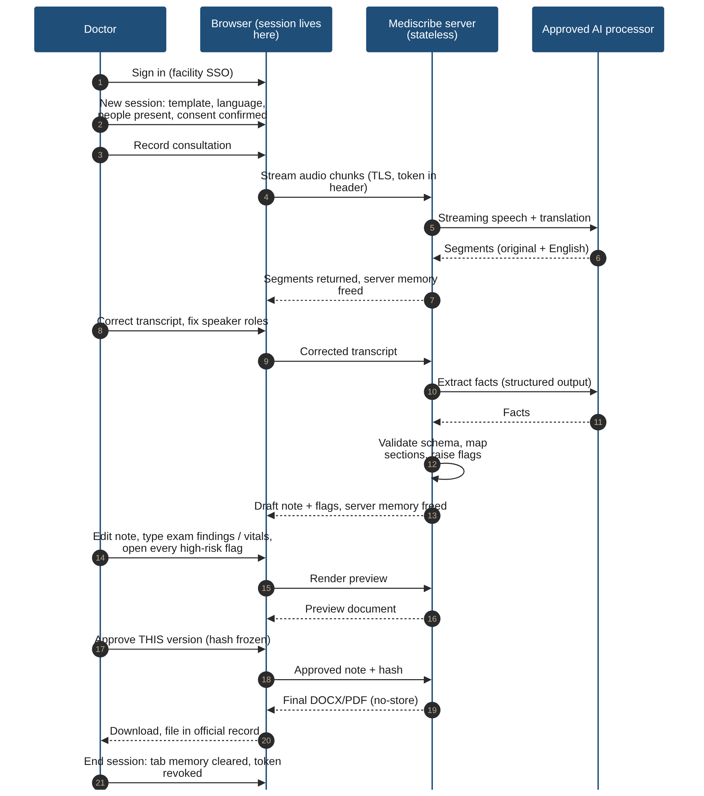

*Figure 1. End-to-end flow of one consultation.*

## 3.1 Workflow steps

1.  Sign in with the facility account.

2.  Start a new temporary session: choose the template, expected
    language(s) and the people present, enter a temporary reference, and
    confirm that the patient was told about the recording and agreed.

3.  Record (or upload synthetic audio) with visible pause, resume and
    stop controls.

4.  Mediscribe streams the audio for transcription and translation;
    segments return with timestamps, the original-language text and the
    English translation.

5.  Correct the transcript and speaker roles.

6.  Mediscribe extracts facts, validates them against the schema, maps
    them into the note and raises review items.

7.  Review the note beside the transcript; type findings that were not
    spoken (examination, vitals); open every HIGH review item and
    resolve it or mark it unverified.

8.  Preview the rendered document.

9.  Approve this exact version; Mediscribe freezes its hash and renders
    only that version.

10. Download the file and file it in the official record.

11. End the session; tab memory is cleared and the token revoked.

# 4. Clinical note specification

The note is one encounter document. Figure 2 shows its structure.
Compared with v2.0, it adds vital signs, investigations, medications,
allergies, past/family/social history, a header with people present and
consent, and a footer with the approver and AI declaration.

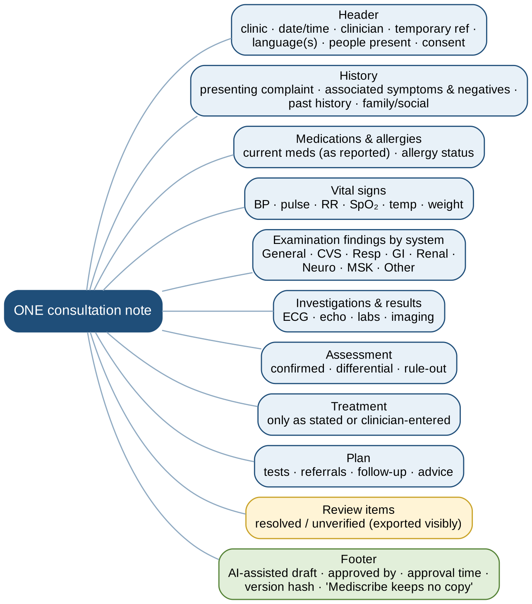

*Figure 2. Structure of the single consultation note.*

## 4.1 Section rules

| **Section**             | **What belongs here**                                                                 | **Rule**                                                                                    |
|-------------------------|---------------------------------------------------------------------------------------|---------------------------------------------------------------------------------------------|
| Header                  | Clinic, date/time, clinician, temporary ref, languages, people present, consent       | Only entered or captured values; never invent identifiers                                   |
| History                 | Presenting complaint, associated symptoms and negatives, past, family, social history | Questions are not facts; keep negation and time; mark who reported it (patient vs relative) |
| Medications & allergies | Current medicines as reported; allergy status                                         | Never complete a missing dose/frequency; unknown allergy status = HIGH flag                 |
| Vital signs             | BP, pulse, RR, SpO₂, temperature, weight                                              | Values only as spoken or entered; missing ones shown as 'not recorded'                      |
| Examination             | Findings by system: General, CVS, Resp, GI, Renal, Neuro, MSK, Other                  | Planned examination ≠ performed; never invent normal findings                               |
| Investigations          | ECG, echo, labs, imaging results stated or entered                                    | Results only; tests to be done go to Plan                                                   |
| Assessment              | Clinician-stated diagnosis, differential, rule-out                                    | Distinguish confirmed vs possible; no independent diagnosis                                 |
| Treatment               | Medicines and other treatment as stated or entered                                    | Name, dose, route, frequency each need a source                                             |
| Plan                    | Tests, referrals, follow-up, advice                                                   | No invented dates or instructions                                                           |
| Review items            | Resolved and unverified items                                                         | Printed on the export (§4.4)                                                                |
| Footer                  | AI-assisted declaration, approver, time, version hash                                 | Generated at render; not stored                                                             |

## 4.2 Provenance – every item has a source

Each item in the note carries one of three source tags, visible during
review: **transcript segment** (time and speaker role), **entered by
clinician**, or **edited by clinician** (with the original kept during
the session). Items with no source fail schema validation and are not
shown.

## 4.3 What the exported document always contains

- Approver's name and approval date-time (from the signed-in identity).

- Consent statement confirmed at session start.

- Languages used and people present.

- Declaration: 'AI-assisted draft generated by Mediscribe; reviewed,
  edited and approved by \[clinician\].'

- Short version hash, so an approved print can be matched to what was
  approved.

- Reminder that Mediscribe keeps no copy.

## 4.4 Review item severity and how each appears on the export

| **Level** | **Examples**                                                                                                                 | **Before approval**                        | **On the exported note**                                                |
|-----------|------------------------------------------------------------------------------------------------------------------------------|--------------------------------------------|-------------------------------------------------------------------------|
| HIGH      | Missing/unclear dose, route or frequency; allergy status unknown; conflicting facts; speaker of a clinical statement unknown | Must be opened; resolve or mark unverified | Resolved: shown normally. Unverified: printed in red as 'UNVERIFIED: …' |
| CHECK     | Possible diagnosis phrased as a question; uncertain body system; inaudible segment                                           | Must be reviewed                           | Listed under Review items if not resolved                               |
| INFO      | Vital sign not recorded; section empty                                                                                       | Visible                                    | Shown as 'not recorded'                                                 |

# 5. System architecture

v2.0 described both the browser and a server 'session coordinator' as
holding the session in memory, without deciding which one. v3.0 decides:
**the session lives only in the browser tab.** Figure 3 shows the three
zones.

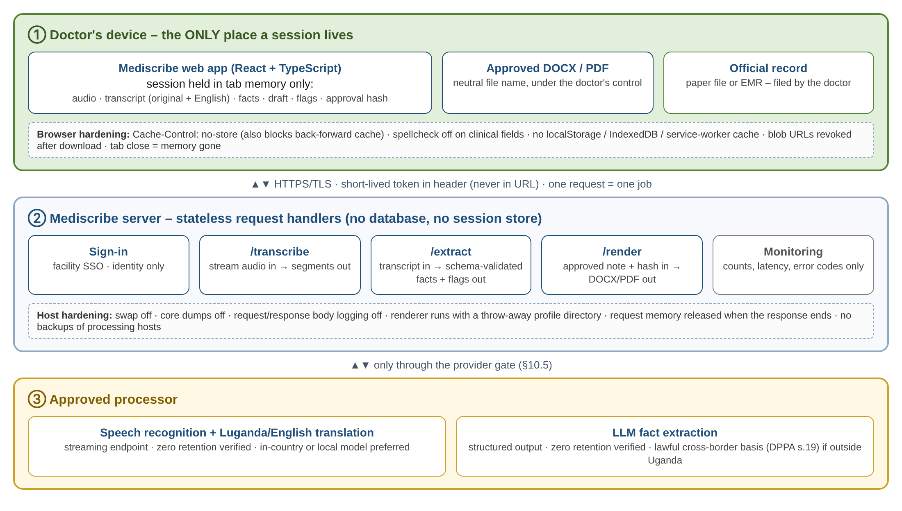

*Figure 3. Architecture: browser-held session, stateless server,
approved processor.*

## 5.1 Components

| **Component**                    | **Responsibility**                                                                | **Storage rule**                                                                                           |
|----------------------------------|-----------------------------------------------------------------------------------|------------------------------------------------------------------------------------------------------------|
| Browser app (React + TypeScript) | Capture audio, show transcript, edit note, hold the whole session, trigger render | JavaScript memory only; no localStorage, IndexedDB, service-worker cache; cleared on End/timeout/tab close |
| Sign-in                          | Authenticate the clinician through facility SSO                                   | Identity only; never linked to clinical content                                                            |
| /transcribe                      | Stream audio to the approved processor; return segments                           | Request-scoped memory; released when the response ends                                                     |
| /extract                         | Send corrected transcript for structured extraction; validate; map; flag          | Request-scoped memory; schema-validated output only                                                        |
| /render                          | Render the approved note to DOCX/PDF after checking the hash                      | In memory or throw-away temp directory deleted in the same request                                         |
| Monitoring                       | Uptime, latency, error codes                                                      | Content-free metrics only                                                                                  |
| Approved processor               | Speech, translation, LLM extraction                                               | Only after the provider gate (§10.5)                                                                       |

## 5.2 Why the browser holds the session

- **Truly stateless server:** restarts, deploys and scaling lose nothing
  and need no sticky sessions.

- **Simple cleanup:** closing the tab or pressing End destroys
  everything; the server has nothing to clean up between requests.

- **Smaller attack surface:** no server-side pile of open drafts to
  leak.

- **Trade-off accepted:** if the tab crashes before download, the draft
  is lost. The UI warns about this clearly (FR-14).

# 6. Session lifecycle

Figure 4 shows the session states. Each transition is defined, including
the error and timeout cases that v2.0 left contradictory.

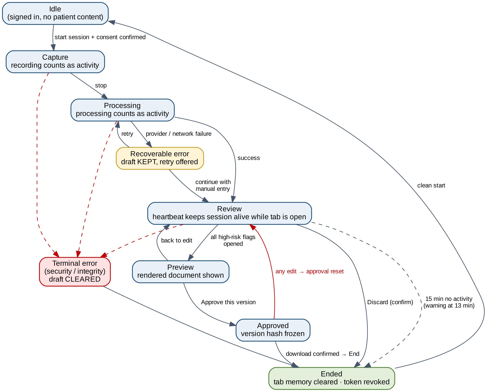

*Figure 4. Session states and transitions.*

## 6.1 States

| **State**  | **Content held (in tab memory)**       | **Ways out**                                 |
|------------|----------------------------------------|----------------------------------------------|
| Idle       | None (signed in only)                  | Start session                                |
| Capture    | Audio buffer                           | Stop · terminal error                        |
| Processing | Audio, partial results                 | Success · recoverable error · terminal error |
| Review     | Transcript, facts, draft, flags, edits | Preview · discard · timeout · terminal error |
| Preview    | Rendered preview                       | Approve · back to edit                       |
| Approved   | Frozen version + hash                  | Download · edit (resets approval) · End      |
| Ended      | Nothing; token revoked                 | Clean start screen                           |

## 6.2 Activity and timeout

- **Counts as activity:** recording, processing, any input, and a
  60-second heartbeat while the review tab is visible.

- **Inactivity timeout:** 15 minutes (prototype default, confirm in
  Phase 0), with a warning and an 'I'm still here' button at 13 minutes.

- **Absolute session limit:** 2 hours; the token cannot be renewed after
  that.

- **On timeout:** clear tab memory, revoke token, return to a clean
  start screen. No restore after refresh.

## 6.3 Error classes

| **Class**   | **Examples**                                                                              | **Behaviour**                                                              |
|-------------|-------------------------------------------------------------------------------------------|----------------------------------------------------------------------------|
| Recoverable | Provider timeout, network drop, malformed AI output, render failure, interrupted download | Keep draft in tab; show error; offer retry; allow manual entry to continue |
| Terminal    | Token invalid or tampered, approved-hash mismatch, integrity or security error            | Clear tab memory, revoke token, show content-free error code               |

# 7. AI processing pipeline

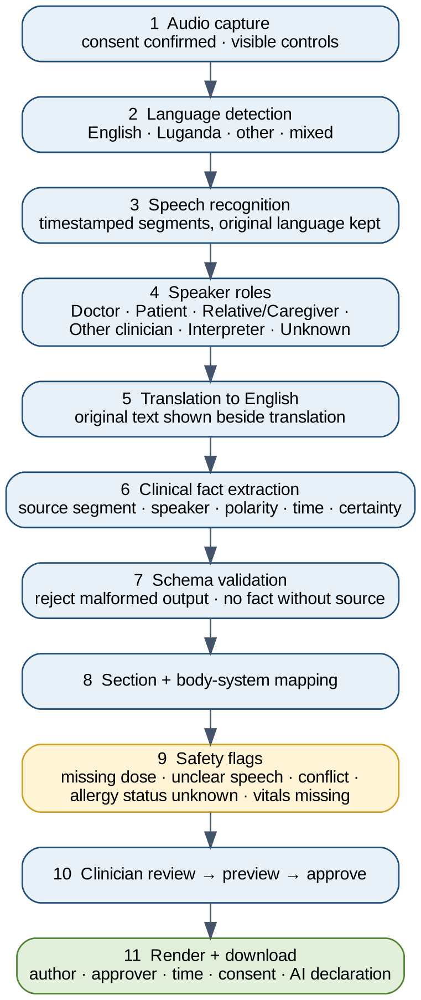

*Figure 5. Processing stages from audio to download.*

## 7.1 Language handling

- Detect the language of each segment; support mixed Luganda–English
  speech.

- Keep the original-language text and show it beside the English
  translation during review.

- Translation output is a draft like any other; uncertain translations
  raise a CHECK item.

- Evaluate speech/translation options that support Luganda (including
  Ugandan-developed models) in the build-vs-buy gate (§13.1).

## 7.2 Speaker roles

| **Role**                     | **Effect on the note**                                               |
|------------------------------|----------------------------------------------------------------------|
| Doctor                       | Clinician statements, findings, assessment, plan                     |
| Patient                      | Patient-reported history                                             |
| Relative / Caregiver         | History marked 'reported by relative', never as patient's own report |
| Other clinician (e.g. nurse) | Vitals and observations marked with source                           |
| Interpreter                  | Translation context; content attributed to the original speaker      |
| Unknown                      | Never forced; clinical content from Unknown raises a HIGH item       |

## 7.3 Extraction rules

- Questions are not facts; an answer is needed.

- Keep negation ('no chest pain') and time ('for three days').

- Separate symptoms, planned examinations, actual findings and
  interpretations.

- Never infer medication name, dose, route, frequency, duration or
  quantity from common practice.

- Do not assign a body system just because the clinic is cardiology.

- Output must match the JSON schema (Appendix A) or it is rejected as a
  recoverable error.

# 8. User interface

The screens are shown with the worked example in §18.

| **Screen**        | **Required elements**                                                                                                                                    |
|-------------------|----------------------------------------------------------------------------------------------------------------------------------------------------------|
| New session       | Template, language(s), people present, temporary reference, consent confirmation, no-storage notice                                                      |
| Record            | Timer, recording indicator, pause/resume/stop, language and connection status                                                                            |
| Review            | Transcript (original + translation, role chips, reassign) beside the draft note (source tags, manual entry, edit/move/delete) and the review-items panel |
| Preview & approve | Approval checklist, rendered preview, version hash, DOCX/PDF choice, 'Approve this version & download', 'Back to edit'                                   |
| Download & end    | Neutral file name, reminder to file in the official record, 'End session & clear'                                                                        |

- Clearly label 'AI DRAFT – not yet approved' until approval.

- Preview stays locked until every HIGH item has been opened (reduces
  rubber-stamping).

- Never show patient lists, recent sessions or 'Save to Mediscribe'.

# 9. Functional requirements

| **ID** | **Requirement**                                                                                | **Priority** |
|--------|------------------------------------------------------------------------------------------------|--------------|
| FR-01  | Clinician signs in with facility SSO before any session                                        | P0           |
| FR-02  | Start a temporary session with no patient profile; record consent confirmation                 | P0           |
| FR-03  | Capture or upload audio with visible controls                                                  | P0           |
| FR-04  | Detect language; transcribe; translate to English; keep originals                              | P0           |
| FR-05  | Label speakers Doctor/Patient/Relative/Other clinician/Interpreter/Unknown; allow reassignment | P0           |
| FR-06  | Extract facts with source, speaker, polarity, time, certainty; validate schema                 | P0           |
| FR-07  | Manual clinician entry in every section (findings, vitals, results, meds)                      | P0           |
| FR-08  | Generate one note with all §4 sections and review items                                        | P0           |
| FR-09  | Lock preview until all HIGH items are opened                                                   | P0           |
| FR-10  | Render preview; approve exact version; any edit resets approval                                | P0           |
| FR-11  | Render export only when the approved hash matches                                              | P0           |
| FR-12  | Export includes approver, time, consent, languages, AI declaration, unverified items           | P0           |
| FR-13  | Download with neutral file name; no server copy                                                | P0           |
| FR-14  | Warn that closing or refreshing the tab loses an unexported draft                              | P0           |
| FR-15  | Recoverable errors keep the draft and allow retry; terminal errors clear it                    | P0           |
| FR-16  | Timeout per §6.2, with warning                                                                 | P0           |
| FR-17  | No clinical content in logs, telemetry, caches or browser storage                              | P0           |
| FR-18  | Current-session search in the transcript                                                       | P1           |
| FR-19  | Additional specialty templates after cardiology evaluation                                     | P2           |

# 10. Privacy and security

## 10.1 Data minimisation

- No persistent patient, consultation, transcript, note, approval or
  document storage anywhere in Mediscribe.

- No backups or version history of clinical content.

- Generic error codes and correlation IDs with no patient information.

- Never log clinical text, names, audio, prompts, AI responses or
  document bytes.

## 10.2 Browser hardening

- Cache-Control: no-store on app pages and API responses (this also
  keeps pages out of the back-forward cache).

- No localStorage, sessionStorage, IndexedDB or service-worker caching
  of clinical content.

- spellcheck='false' and autocomplete='off' on clinical fields, so
  browser spelling services do not send text out.

- Advise clinicians to use a browser profile without third-party writing
  extensions.

- Neutral download file names (e.g.
  consultation_note_2026-10-19_1038.docx), so no patient name appears in
  download history.

- Revoke blob URLs and drop audio buffers immediately after use.

## 10.3 Server and host hardening

- Swap disabled and core dumps disabled on processing hosts.

- Request and response body logging disabled at app, proxy and load
  balancer.

- PDF renderer runs with a throw-away profile directory deleted in the
  same request.

- No snapshots or backups of processing hosts; ephemeral compute only.

- Crash reporting configured to strip request data.

## 10.4 Access

- Facility SSO sign-in (identity only, never linked to clinical
  content).

- Short-lived session token carried in an Authorization header or
  HttpOnly, Secure, SameSite cookie – never in the URL.

- Rate and upload limits per user; CSRF protection; TLS everywhere.

- API keys only in server-side secret management.

## 10.5 Provider gate

No real patient content goes to any speech, translation or AI provider
until all of the following are verified for the exact endpoint and
account:

1.  Zero retention (including abuse monitoring) – in writing, for that
    endpoint.

2.  Streaming or synchronous processing; no requirement to upload audio
    to a storage bucket.

3.  Processing location, and a lawful basis for any processing outside
    Uganda (§11).

4.  Subprocessors listed; deletion and breach-notice terms.

5.  Quality on Luganda/mixed speech and medical vocabulary, measured
    with synthetic audio.

6.  If any item fails: use synthetic data only, or a locally hosted
    model.

## 10.6 Limits of the no-storage promise

Mediscribe can guarantee what its own code and hosts do. It cannot prove
that the network, operating system or a provider keeps nothing unless
that has been verified. The team must not claim 'data exists nowhere'.
The downloaded file is the doctor's responsibility once saved.

# 11. Legal and governance (Uganda)

Uganda's Data Protection and Privacy Act, 2019 (DPPA) and its 2021
Regulations apply. The table maps the key obligations to design
decisions. It is a planning aid, not legal advice: the facility's
data-protection officer and legal adviser must confirm it.

| **Obligation (DPPA 2019)**                                                                                                 | **What it means for Mediscribe**                                                                                       |
|----------------------------------------------------------------------------------------------------------------------------|------------------------------------------------------------------------------------------------------------------------|
| Health information is 'special personal data' (s.9) – processed only where the law permits                                 | Document the lawful basis with the facility before any real use                                                        |
| Processing or storage outside Uganda only if the destination has equivalent protection or the data subject consents (s.19) | Prefer in-country or local processing; otherwise the consent wording must cover it and the provider gate must check it |
| Collectors, processors and controllers register with the Personal Data Protection Office (PDPO)                            | Facility and/or Mediscribe operator registers before the pilot                                                         |
| Breaches must be notified to the PDPO (s.23)                                                                               | Incident-response plan names who notifies and how                                                                      |
| Consent and purpose limitation                                                                                             | Consent statement captured each session and printed on the note                                                        |

## 11.1 Approvals required before any real-patient pilot

- Facility management approval and named clinical lead.

- Ethics/research committee review if the pilot is evaluated as
  research.

- Data-flow map and data-protection impact assessment signed off.

- Provider gate passed (§10.5).

- Security assessment and verified cleanup tests (§15.2).

- Incident-response procedure, including PDPO notification.

# 12. Export and failure handling

## 12.1 Export sequence

1.  All HIGH items opened; each resolved or marked unverified.

2.  Preview rendered and shown.

3.  Clinician presses 'Approve this version & download'; hash frozen.

4.  /render checks the hash, renders in memory and streams with no-store
    headers.

5.  Browser saves with a neutral file name; blob URL revoked.

6.  Reminder to file in the official record; 'End session & clear'.

## 12.2 Failures

| **Failure**                           | **Class**   | **Behaviour**                                               |
|---------------------------------------|-------------|-------------------------------------------------------------|
| Transcription/translation unavailable | Recoverable | Keep audio in tab; retry; or continue with manual entry     |
| Malformed AI output                   | Recoverable | Reject; retry extraction; never show partial invalid output |
| Network interruption                  | Recoverable | Show connection state; retry while session valid            |
| Render failure / interrupted download | Recoverable | Keep approved version; regenerate                           |
| Uncertain speaker                     | —           | Label Unknown; HIGH item if clinical content                |
| Tab refresh or crash                  | —           | Draft lost by design; warned beforehand                     |
| Timeout                               | —           | Clear and return to start (§6.2)                            |
| Hash mismatch / token tampering       | Terminal    | Clear; content-free error code; security event              |

# 13. Technology choices

| **Layer**            | **Choice**                                                 | **Notes**                                                        |
|----------------------|------------------------------------------------------------|------------------------------------------------------------------|
| Frontend             | React + TypeScript                                         | State in memory (e.g. React state / Zustand without persistence) |
| Backend              | Python + FastAPI                                           | Stateless handlers; matches python-docx                          |
| Documents            | python-docx; PDF via sandboxed LibreOffice headless        | Throw-away profile and temp directory per request                |
| Speech + translation | Streaming API or locally hosted model with Luganda support | Chosen through the provider gate                                 |
| Extraction           | Structured-output LLM (API or local)                       | JSON-schema validation; zero retention                           |
| Auth                 | Facility SSO (OIDC/SAML)                                   | Identity only                                                    |
| Hosting              | Ephemeral containers, swap off, no snapshots               | In-country hosting preferred                                     |
| Database             | None                                                       | No clinical database or session store                            |

## 13.1 Build-vs-buy gate

Compare options on Luganda/mixed-speech accuracy, medical vocabulary,
speaker roles, streaming support, retention, processing location, cost
and failure behaviour – using synthetic audio only.

# 14. Build roadmap

Governance now starts in Phase 0, because its result (for example, no
processing outside Uganda) can change the architecture. Dates are
indicative.

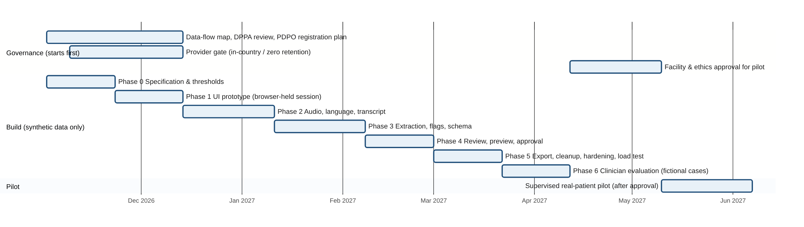

*Figure 6. Indicative roadmap; governance runs in parallel from the
start.*

| **Phase**            | **Work**                                                    | **Exit criteria (measurable)**                                                 |
|----------------------|-------------------------------------------------------------|--------------------------------------------------------------------------------|
| 0 Specification      | Note template, thresholds, data-flow map, DPPA review start | Spec signed off; data-flow map agreed; thresholds in §15 confirmed             |
| 1 UI prototype       | Browser-held session with synthetic text                    | ≥ 9 of 10 test clinicians correctly explain data-loss behaviour                |
| 2 Audio & language   | Capture, streaming STT, translation, speaker roles          | WER and speaker accuracy measured on synthetic English, Luganda and mixed sets |
| 3 Structured note    | Extraction, schema, mapping, flags                          | 0 critical safety errors on the adversarial set (§15.1)                        |
| 4 Review & approval  | Side-by-side review, manual entry, preview, hash approval   | 100% of exports match approved hash; 0 exports without approval                |
| 5 Export & hardening | Render, cleanup, browser/host hardening, load test          | 0 synthetic markers found anywhere after sessions; load test passed            |
| 6 Evaluation         | Clinicians run fictional cases                              | Results report; median review time recorded                                    |
| 7 Pilot (gated)      | Supervised real-patient pilot                               | Only after all §11.1 approvals are in writing                                  |

# 15. Testing and acceptance

## 15.1 Clinical safety tests (adversarial synthetic set)

| **Test**                                                               | **Target**                                      |
|------------------------------------------------------------------------|-------------------------------------------------|
| Negation preserved ('I do not have shortness of breath')               | 0 errors                                        |
| Question not converted into diagnosis ('Could this be heart failure?') | 0 errors                                        |
| Doctor question not converted into patient fact                        | 0 errors                                        |
| Planned examination not shown as done                                  | 0 errors                                        |
| Missing medication detail invented                                     | 0 errors                                        |
| Relative's report labelled as patient's                                | 0 errors after review prompts                   |
| Body system assigned only from specialty                               | 0 errors                                        |
| Every note item has a source tag                                       | 100%                                            |
| Speaker role accuracy, clear audio                                     | ≥ 95% (rest marked Unknown)                     |
| Word error rate, English / Luganda / mixed                             | Baseline in Phase 2; targets set before Phase 3 |

## 15.2 Statelessness and privacy tests

- Seed synthetic marker strings; after sessions search server disk,
  temp, logs, telemetry, crash reports and backups – target 0 hits.

- Browser: no markers in localStorage, IndexedDB, cache, service
  workers, back-forward cache or download file names.

- Server restart during a session loses nothing server-side (there is
  nothing to lose).

- Export responses carry no-store and are not cached by proxies.

- Provider configuration matches the claimed retention for every
  endpoint.

## 15.3 Load and reliability

- Expected concurrent clinicians × 30-minute recordings: memory stays
  within limits; no swap.

- Download success rate ≥ 99% on the target network; retry works.

## 15.4 Definition of done (MVP)

1.  A fictional mixed-language consultation is recorded, transcribed and
    translated.

2.  Speaker roles are correct or Unknown, and editable.

3.  One note with all §4 sections and source tags is produced.

4.  All §15.1 targets are met.

5.  Preview, hash approval and export work; unverified items print
    visibly.

6.  All §15.2 tests find 0 markers.

7.  Test report documents quality, safety errors, review time, export
    reliability and cleanup results.

# 16. Risks and mitigations

| **Risk**                                     | **Mitigation**                                                                 |
|----------------------------------------------|--------------------------------------------------------------------------------|
| Provider retains data or processes it abroad | Provider gate; in-country/local model preferred; synthetic data until approved |
| Clinical hallucination or omission           | Source tags, schema validation, flags, preview + approval, adversarial tests   |
| Automation bias (rubber-stamp approval)      | HIGH items must be opened; unverified items printed; review time measured      |
| Translation error                            | Original text shown beside translation; CHECK items on low confidence          |
| Wrong speaker role                           | Role chips, reassignment, Unknown never forced                                 |
| Doctor loses unexported note                 | Clear warnings, heartbeat, reliable export, recoverable errors keep draft      |
| Sensitive data in logs/telemetry/swap        | Body logging off, swap/core dumps off, marker tests                            |
| Downloaded file left on shared device        | Neutral file names; reminder to file and delete; facility device policy        |
| No longitudinal history                      | State limitation; clinician uses official record                               |
| Real-patient use starts too early            | Written approvals gate the pilot                                               |

# 17. Decisions before real-patient use

| **Decision**                                                           | **Proposed owner**                       |
|------------------------------------------------------------------------|------------------------------------------|
| Final note layout and wording                                          | Clinical lead                            |
| Inactivity timeout and absolute limit                                  | Clinical lead + security lead            |
| Speech/translation/LLM provider or local model                         | Technical lead + data-protection officer |
| Lawful basis and consent wording (incl. s.19 if any processing abroad) | Data-protection officer / legal          |
| PDPO registration                                                      | Facility administration                  |
| How exports reach the paper file or EMR                                | Ward/clinic managers                     |
| Who verifies cleanup and handles incidents                             | Security lead                            |

# 18. Worked example – a fictional patient

<table>
<colgroup>
<col style="width: 100%" />
</colgroup>
<tbody>
<tr class="odd">
<td>
<strong>Demonstration only</strong>

All names, people and clinical details below are invented to show how
the system behaves. 'Ronald Kato' and 'Dr. A. Nankya' are fictional. No
real patient data was used.
</td>
</tr>
</tbody>
</table>

## 18.1 Scenario

Ronald Kato (fictional), 58, attends a cardiology clinic with chest
pain. His wife and a nurse are present. He speaks a mix of Luganda and
English. The consultation lasts about two minutes of recorded speech for
this demonstration.

## 18.2 What was said (excerpt)

| **Time** | **Speaker role** | **Original**                                                                      | **English (as shown in review)**             |
|----------|------------------|-----------------------------------------------------------------------------------|----------------------------------------------|
| 00:08    | Patient          | Musawo, nfuna obulumi mu kifuba for three days.                                   | Doctor, I have chest pain for three days.    |
| 00:16    | Doctor           | Does the pain go to your arm or jaw?                                              | —                                            |
| 00:19    | Patient          | Nedda.                                                                            | No.                                          |
| 00:25    | Patient          | Yes, on the stairs it becomes bad.                                                | —                                            |
| 00:31    | Relative – wife  | Ekiro azuukuka nga takyasobola kussa bulungi.                                     | At night he wakes up unable to breathe well. |
| 00:43    | Patient          | Not that I know. (allergies)                                                      | —                                            |
| 00:50    | Patient          | The one for pressure… amlodipine, I think.                                        | —                                            |
| 01:02    | Nurse            | His weight is 82 kilograms.                                                       | —                                            |
| 01:10    | Doctor           | Pulse is irregular, about 110. Blood pressure 150 over 95.                        | —                                            |
| 01:18    | Doctor           | There are fine crackles at both lung bases.                                       | —                                            |
| 01:26    | Doctor           | The ECG shows atrial fibrillation.                                                | —                                            |
| 01:33    | Doctor           | My impression is atrial fibrillation. Heart failure is possible; we need an echo. | —                                            |
| 01:41    | Doctor           | We start bisoprolol \[inaudible\] milligrams once daily.                          | —                                            |
| 01:49    | Unknown          | \[inaudible\]                                                                     | —                                            |
| 01:55    | Doctor           | Do an echo and kidney function, and come back in two weeks.                       | —                                            |

The Luganda lines are illustrative and should be checked by a fluent
speaker before use in training material.

## 18.3 Step by step through the app

**Step 1 – New session.** Dr. Nankya chooses the cardiology template,
expects Luganda + English, adds the wife and nurse as people present,
and confirms consent.

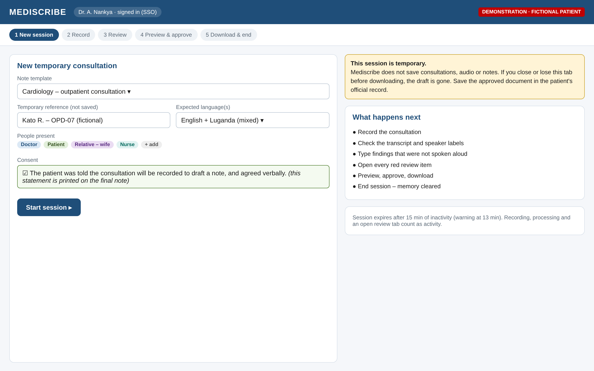

*Figure 7. New-session screen: template, languages, people present and
consent.*

**Step 2 – Record.** Audio streams to /transcribe; languages and four
speakers are detected. Nothing is written to disk.

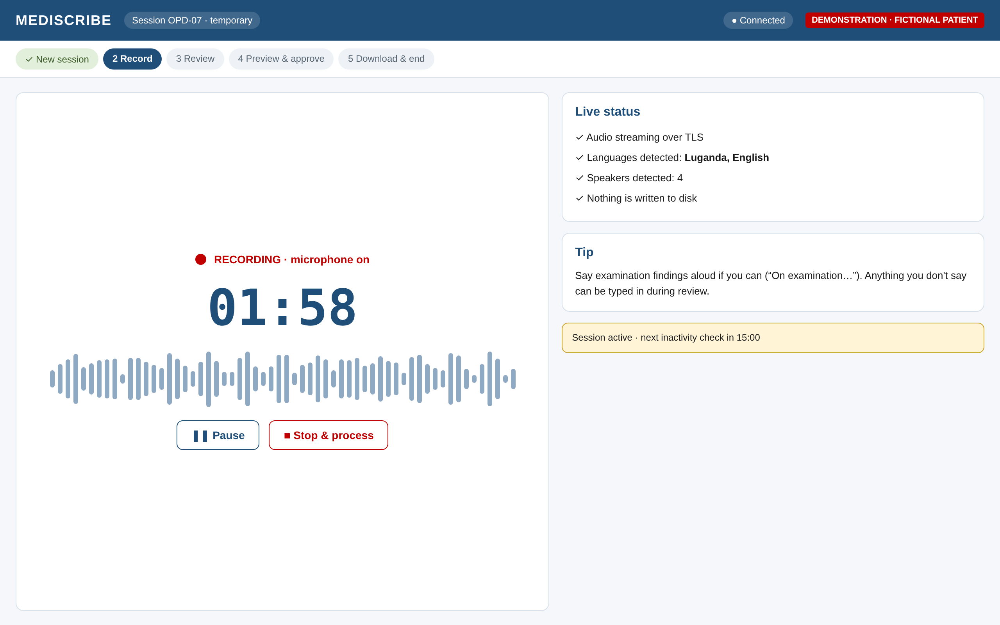

*Figure 8. Recording screen.*

**Step 3 – Review.** The transcript (Luganda original plus English) sits
beside the draft note. The wife's report is labelled 'reported by wife',
not as the patient's own. Dr. Nankya types the ankle oedema she saw but
did not say aloud. Five review items appear; two are HIGH.

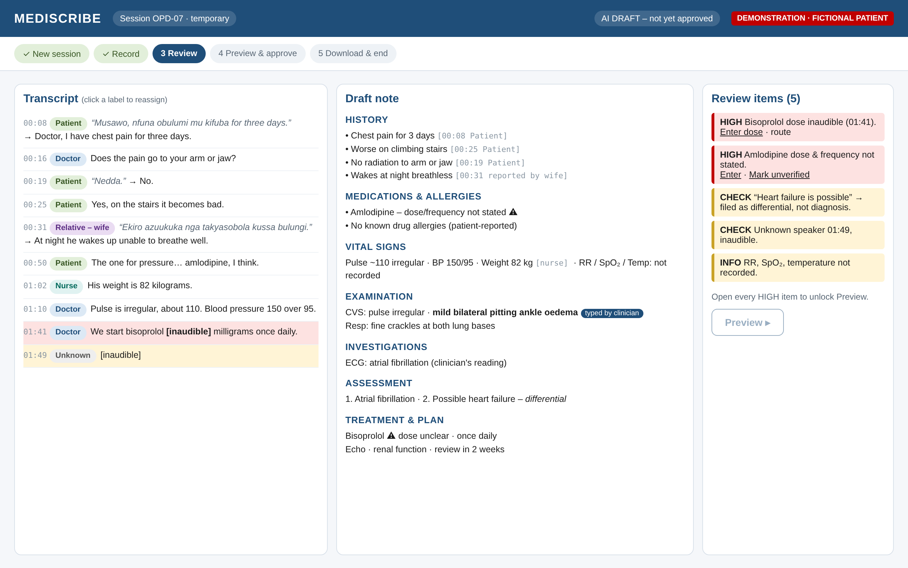

*Figure 9. Review screen: transcript, draft note with source tags, and
review items.*

| **Review item**                      | **Level** | **What Dr. Nankya did**            | **Result on export**                            |
|--------------------------------------|-----------|------------------------------------|-------------------------------------------------|
| Bisoprolol dose inaudible            | HIGH      | Entered 2.5 mg, oral               | Printed normally, marked 'entered by clinician' |
| Amlodipine dose/frequency not stated | HIGH      | Marked unverified (patient unsure) | Printed in red: UNVERIFIED                      |
| 'Heart failure is possible'          | CHECK     | Confirmed as differential          | Assessment: 'possible – not confirmed'          |
| Unknown speaker, inaudible           | CHECK     | Acknowledged – no clinical content | Listed under Review items                       |
| RR, SpO₂, temperature missing        | INFO      | Left as not recorded               | 'not recorded'                                  |

**Step 4 – Preview and approve.** With both HIGH items opened, Preview
unlocks. She checks the rendered document and approves version
a3f9-27c1.

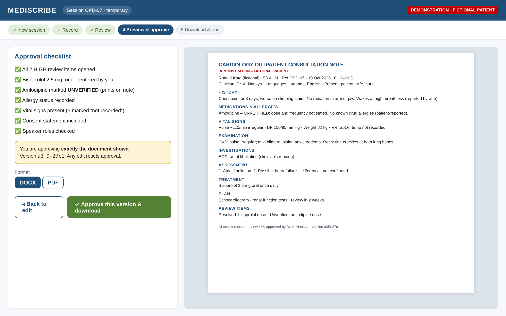

*Figure 10. Preview & approve screen: checklist, rendered preview and
version hash.*

**Step 5 – Download and end.** The file downloads with a neutral name.
She files it in the patient's record and ends the session.

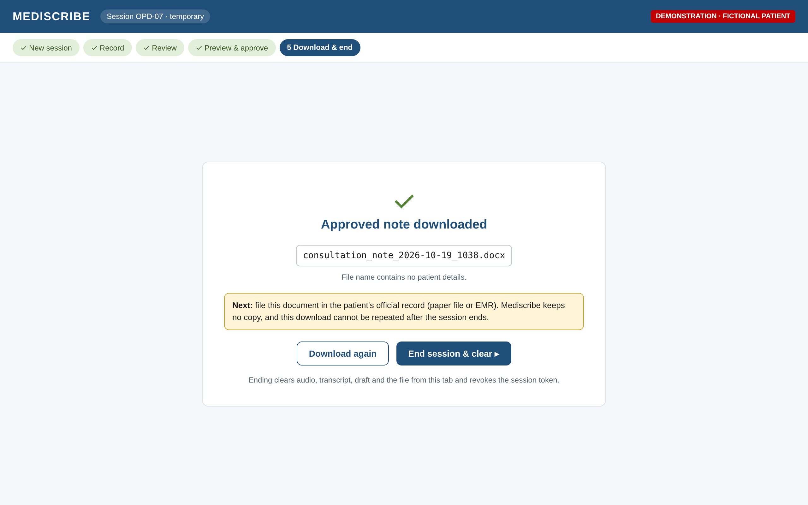

*Figure 11. Download & end screen.*

## 18.4 Where the data is at each moment

| **Moment**       | **In the browser tab**          | **On the Mediscribe server**                   | **Kept afterwards**             |
|------------------|---------------------------------|------------------------------------------------|---------------------------------|
| Recording        | Audio buffer                    | Audio chunk only during each streaming request | Nothing                         |
| Review           | Transcript, facts, draft, flags | Nothing (between requests)                     | Nothing                         |
| Approve & render | Approved version + hash         | Note in memory during the /render request      | Nothing                         |
| After download   | File in Downloads folder        | Nothing                                        | Doctor's file only              |
| After End        | Nothing; token revoked          | Nothing                                        | Doctor's file → official record |

## 18.5 The final output

Figure 12 is the approved consultation note exactly as downloaded (DOCX,
one A4 page). The same file is included alongside this document.

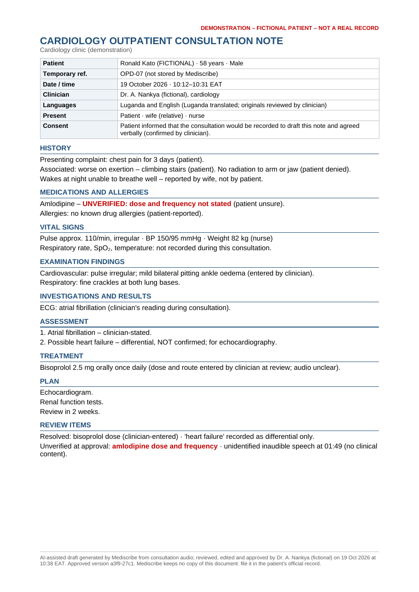

*Figure 12. Final exported note for the fictional patient.*

# Appendix A. Note schema (simplified)

Every extraction response must validate against this structure, or it is
rejected.

{

"header": { "clinic", "datetime", "clinician", "temp_ref",

"languages": \[\], "present": \[\], "consent_statement" },

"items": \[ {

"id": "f-012",

"section": "history \| meds_allergies \| vitals \| exam \|
investigations \|

assessment \| treatment \| plan",

"body_system": "general \| cvs \| resp \| gi \| renal \| neuro \| msk \|
other \| null",

"text": "Chest pain for 3 days",

"polarity": "present \| absent",

"certainty": "confirmed \| possible \| rule_out",

"time": "3 days",

"source": { "type": "segment \| clinician_entered \| clinician_edited",

"segment_id": "s-002", "speaker_role": "patient" }

} \],

"review_items": \[ { "id", "level": "HIGH \| CHECK \| INFO", "item_id",

"reason", "status": "open \| resolved \| unverified" } \],

"approval": { "approved_by", "approved_at", "version_hash" } // in tab
memory only

}

# Appendix B. Implementation checklist

- [ ] No database, session store or storage bucket for clinical content

- [ ] Session held only in browser memory; End/timeout/tab close clears
  it

- [ ] No localStorage / IndexedDB / service-worker cache; Cache-Control:
  no-store

- [ ] Spellcheck/autocomplete off on clinical fields; neutral file
  names; blob URLs revoked

- [ ] Facility SSO; token in header/HttpOnly cookie; rate and upload
  limits

- [ ] Swap and core dumps off; body logging off; throw-away renderer
  profile

- [ ] Provider gate passed for every endpoint (streaming, zero
  retention, location)

- [ ] DPPA review, PDPO registration plan, consent wording agreed

- [ ] Language detection, translation with originals, six speaker roles

- [ ] All §4 sections; manual entry everywhere; source tags on every
  item

- [ ] HIGH items lock preview; edit resets approval; hash checked at
  render

- [ ] Export header/footer: approver, time, consent, AI declaration,
  unverified items

- [ ] §15 safety targets met; 0 markers in privacy tests; load test
  passed

- [ ] Written approvals before any real patient data

# Appendix C. Sources

- Mediscribe Stateless Project Documentation v2.0 (18 October 2026) and
  its review (19 October 2026).

- Uganda Data Protection and Privacy Act, 2019 –
  https://ulii.org/akn/ug/act/2019/9

- DLA Piper, Data Protection Laws of the World: Uganda –
  https://www.dlapiperdataprotection.com/?c=UG&t=law
